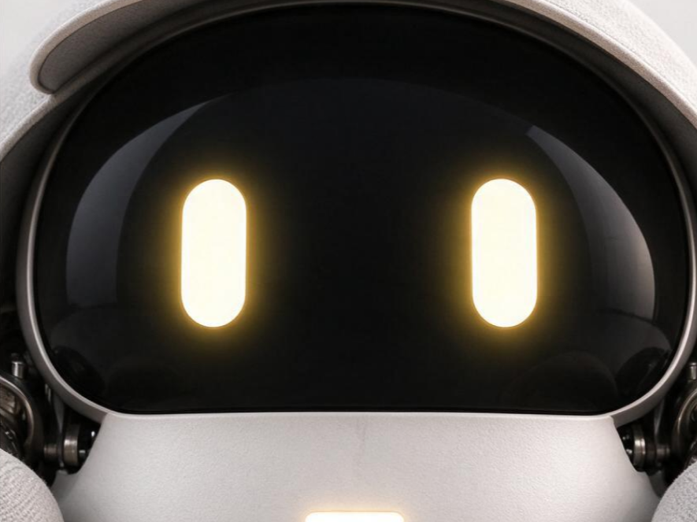

# TADA｜会收集声音的具身伙伴

TADA 是一款围绕“收听、探索、回应”设计的机器人概念。它有两种表现方向：柔软的陪伴形态通过触碰和收集到的声音回应人；具身形态以六足移动，两层上壳各自沿轴旋转。这个仓库把产品装配、声音交互和 MuJoCo 桌面仿真放进同一个网页，便于展示设计与运行逻辑。

[打开在线演示](https://shoreee.github.io/Craboo/) · [设计来源（Figma）](https://www.figma.com/design/ArMemjzqOWaviRnjjgPbjF/806-1?node-id=499-17)

<p align="center"> </p>

## 网页里可以做什么

| 页面 | 内容 |
| --- | --- |
| 产品 | 拖动三维模型观察外观，向下滚动查看六足、身体、收音部件、面部与两层上壳的逐步装配。 |
| 陪伴 | 用手势轻抚或轻拍二维毛绒形态；录音、导入音频，试听它用已保存片段组成的回应。 |
| 仿真 | 在浏览器内运行 MuJoCo 桌面场景。自动寻找使用场景坐标选择目标；手动模式用 WASD 移动和转向。点击机器人可触摸，Ctrl＋拖动施加外力，两层上壳可分别旋转。 |
| 我的 | 查看按原录音整理的声音片段，调整切段、试听、标注与保存。 |
| 学习 | 用已标注片段训练声音类别和偏好两个本地模型，并比较最近片段与存档平均的七项声学特征。 |

实时聆听使用浏览器麦克风和 AudioWorklet，将持续输入按声音活动与停顿切为候选片段。录音降噪调用浏览器原生音频处理。声音与模型保存在当前浏览器；页面不会把音频上传到服务器。声音回应是已保存片段的选择与拼接，不是语义语音合成。

## 本地运行

需要 Node.js。仓库包含网页所需的 Three.js 和 MuJoCo 浏览器文件；无需运行 Python 训练代码即可打开网站。

```sh
node server.mjs
```

打开 `http://localhost:4173/`。首次打开仿真需加载 WebAssembly 与场景资源；实时聆听需允许麦克风权限。

## 仓库结构

```text
assets/                 产品图片、三维模型与浏览器仿真场景
src/                    页面、装配动画、录音处理、学习与仿真交互
tests/                  声音切段和学习逻辑测试
vendor/                 浏览器端 Three.js 与 MuJoCo
simulation-training/    MuJoCo 六足场景、PPO 训练与评估的可复现子项目
```

网页的行走控制使用从仿真项目导出的 `lifted` 交替三足参考参数；`simulation-training/` 中的 PPO 检查点用于研究和成对评估，**网页没有加载该检查点**。训练场景的质量、摩擦与关节力矩是仿真参数，尚未以实体硬件测量值校准。训练方法与运行命令见 [仿真训练说明](simulation-training/README.md)。

单足结构演示保留原文件的 MIT 许可声明，见 [LICENSE-anatomy.txt](LICENSE-anatomy.txt)。
